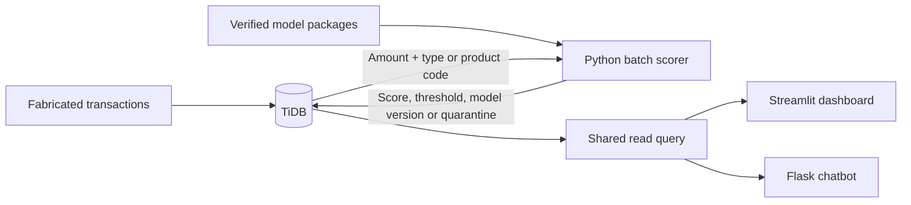

# Fraud Detection and Risk Intelligence

[](https://github.com/ytahoon/Fraud-Detection/actions/workflows/test.yml)

A portfolio project that compares fraud models on **IEEE-CIS** and **Synthetic Financial (PaySim)** and turns predictions into a review workflow. A Python scorer writes versioned results to TiDB. The Streamlit dashboard and Flask chatbot read the same stored result.

## Run the demo

Start Docker with Compose, then run:

```bash
git clone https://github.com/ytahoon/Fraud-Detection.git
cd Fraud-Detection
docker compose up --build -d
```

No Kaggle data, cloud credentials, or Gemini key is required. The stack loads **12 fabricated transactions**, scores both datasets, and binds only to localhost.

- **Dashboard:** [http://127.0.0.1:8502](http://127.0.0.1:8502). Switch datasets and find `DEMO-001`; the transaction ID is reused intentionally to demonstrate dataset isolation.
- **Research Analytics:** In the dashboard sidebar, choose either dataset to explore class balance, time trends, segment risk, amount distributions, and chronological evaluation results. This view works without CSVs or TiDB.
- **Chatbot:** [Open the transaction assistant](http://127.0.0.1:5002/chat), choose a dataset, and try `DEMO-001`. The browser and API use the same stored scores as the dashboard.
- **Chatbot API:** [IEEE-CIS lookup](http://127.0.0.1:5002/transactions/ieee_cis/DEMO-001) or [PaySim lookup](http://127.0.0.1:5002/transactions/synthetic_financial/DEMO-001).

```bash
curl -X POST http://127.0.0.1:5002/chat -H "Content-Type: application/json" \
  -d '{"message":"Check DEMO-001 in Synthetic Financial"}'
```

Stop the disposable stack with `docker compose down`. If the ports are busy, set
`DASHBOARD_PORT` and `CHATBOT_PORT` when starting it. See [setup and troubleshooting](docs/SETUP.md).

## Architecture



Transactions are keyed by dataset and transaction ID. Each model version can score a transaction once. Failed input checks go to quarantine rather than getting a made-up score. Fraud labels are stored separately from review recommendations.

## Verified research results

| Dataset | Selected model | Holdout rows | Average precision | Fraud precision | Fraud recall |
| --- | --- | ---: | ---: | ---: | ---: |
| IEEE-CIS | LightGBM | 94,636 | 0.1152 | 15.54% | 23.22% |
| Synthetic Financial (PaySim) | XGBoost | 298,584 | 0.2872 | 24.76% | 31.44% |

These are chronological holdout results, not live performance. The public quickstart uses a **separate IEEE-CIS fixture model** trained on fabricated data; its scores do not represent the IEEE-CIS research result. The PaySim quickstart uses the verified XGBoost package. Neither model is intended to approve or block payments.

- [Research methods, baselines, and data sources](docs/RESEARCH.md)
- [IEEE-CIS validation report](artifacts/models/ieee_cis_pre_auth_v1_0/validation.json) and [PaySim validation report](artifacts/models/synthetic_financial_pre_auth_v1_1/validation.json)
- [Notebooks](notebooks/) and [public demo fixtures](src/database/demo_transactions.json)

## Tests

The [GitHub Actions workflow](.github/workflows/test.yml) starts this same stack and runs tests against a separate database inside its TiDB container. It checks model packaging, both datasets, idempotent scoring, quarantine recovery, and score parity across TiDB, the dashboard, and the chatbot.

```bash
docker compose run --rm --no-deps \
  -e RUN_TIDB_INTEGRATION=1 -e TIDB_DEMO_DATABASE=fraud_detection_ci_demo \
  bootstrap python -m unittest discover -s tests -v
```
